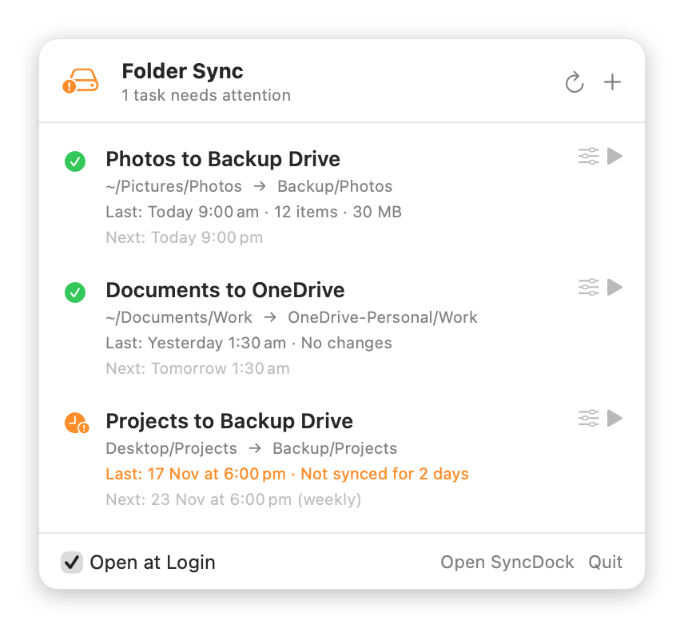
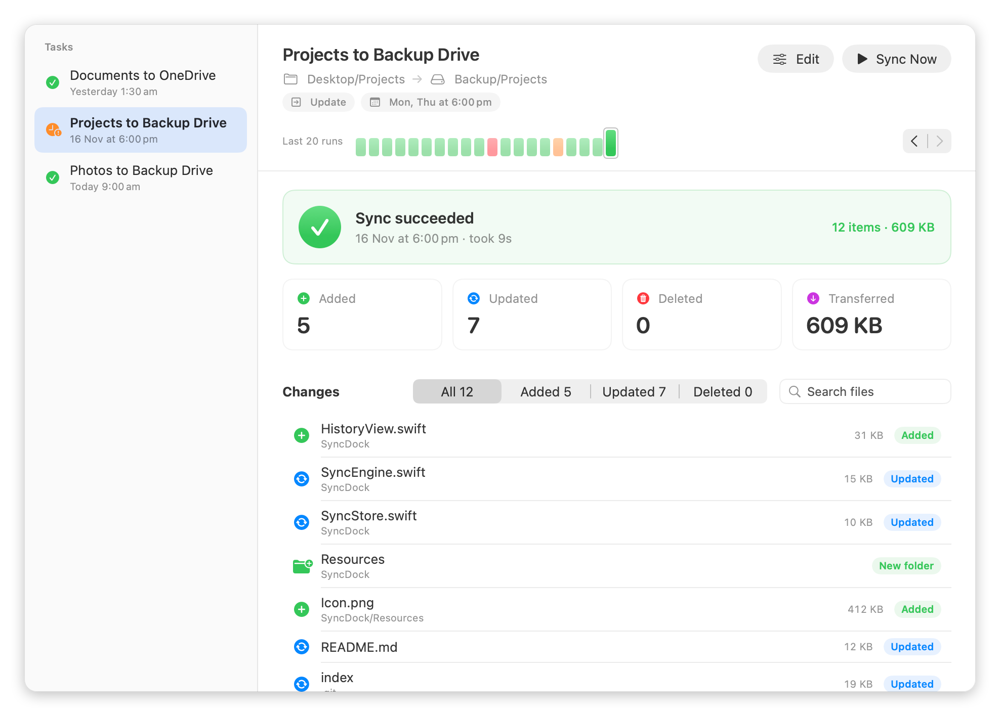
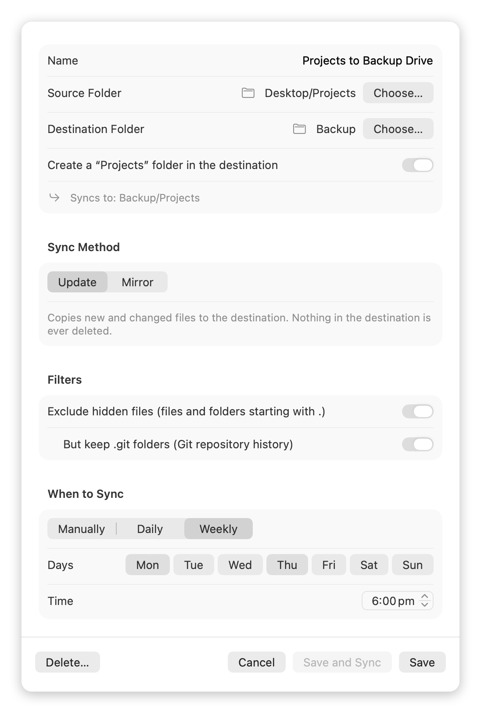
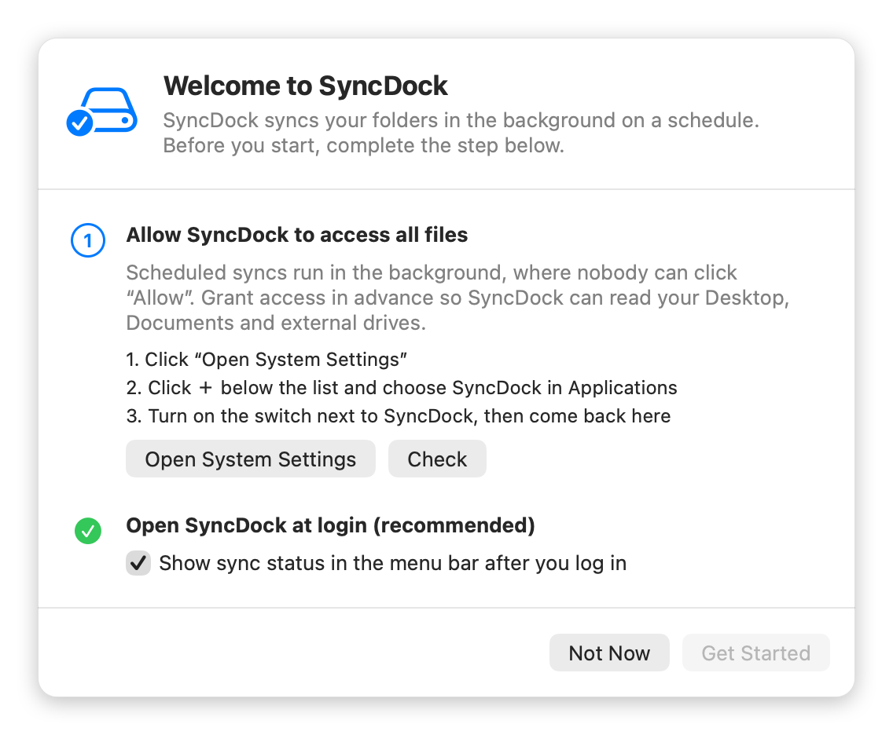

# SyncDock

[中文](README.zh-CN.md) | **English**

A macOS menu bar app for keeping folders in sync with a simple interface: pick a source and a destination folder, choose when to sync, and SyncDock takes care of the rest in the background.

SyncDock does the syncing itself with a built-in one-way sync engine. There's nothing else to install.

<p align="center"></p>

## Download

**[⬇ Download SyncDock for macOS](https://github.com/yuting-ai/SyncDock/releases/latest/download/SyncDock.dmg)**

macOS 15 or later · Apple silicon and Intel · Notarized by Apple · Free and open source (MIT)

All versions and release notes: [Releases](https://github.com/yuting-ai/SyncDock/releases)

## Screenshots

<p align="center"></p>

<table>
  <tr>
    <th>Editing a task</th>
    <th>First-run setup</th>
  </tr>
  <tr>
    <td valign="top"></td>
    <td valign="top"></td>
  </tr>
</table>

## Features

- **Status in the menu bar**: each task's last result (how many items, how much data) and its next scheduled run.
- **Sync history**: a window with each task's last 30 runs: result, duration, what was added, updated and deleted, any errors, and a searchable list of every changed file.
- **Create and edit tasks**: choose a source and a destination folder. By default SyncDock creates a folder named after the source inside the destination, and shows exactly where files will go.
- **Two sync methods**
  - **Update**: copies new and changed files to the destination and never deletes anything there (default).
  - **Mirror**: makes the destination identical to the source; files deleted from the source are also deleted from the destination (moved to the Trash).
- **Filters**: exclude hidden files, optionally keeping `.git` folders (handy for backing up code).
- **Schedules**: manual, daily, or on chosen weekdays. Runs in the background with **no app needing to stay open**.
- **Sync Now**: run any task once, whenever you like.
- **External drive aware**: if the drive isn't connected, the sync is skipped with a notification, so nothing is written to your internal disk by mistake.
- **First-run setup**: checks that SyncDock has Full Disk Access and walks you through granting it.
- **Chinese and English interface**: follows your system language.

## Requirements

- macOS 15 or later (Apple silicon or Intel)

## Installation

1. [Download SyncDock.dmg](https://github.com/yuting-ai/SyncDock/releases/latest/download/SyncDock.dmg), open it, and drag SyncDock into the Applications folder.
2. Open SyncDock. It has no window and no Dock icon; it appears in the **menu bar** at the top right of the screen.
3. The first time, a “Welcome to SyncDock” window asks you to **allow SyncDock to access all files**: click “Open System Settings”, click ＋ below the Full Disk Access list, choose SyncDock and turn on its switch. SyncDock checks again when you come back.

> **Why Full Disk Access?** Scheduled syncs run in the background, where nobody can click “Allow”. Granting access in advance lets SyncDock read your Desktop, Documents and external drives.

### Upgrading from SyncDock 1.x

Versions 1.x ran syncs with FreeFileSync. Once 2.0 has Full Disk Access (see above), your tasks move over to the built-in engine automatically, keeping their names, folders, sync method, filters and schedules. Until then FreeFileSync keeps running them, so no backup is missed. The `.ffs_batch` files in `~/FreeFileSync` are left in place, and you can uninstall FreeFileSync if you don't use it otherwise.

Tasks with settings SyncDock doesn't offer (two-way sync, size or date filters, extra filter rules) are not moved: they keep running in FreeFileSync as before, and SyncDock doesn't show them.

## Usage

Click SyncDock in the menu bar to open the panel:

| To | Use |
|---|---|
| Create a task | ＋ at the top right of the panel |
| Edit or delete a task | ⚙ next to the task |
| Sync a task now | ▶ next to the task |
| See what a sync did | Click the “Last: …” line under the task, or “Sync History” at the bottom of the panel |
| Start SyncDock when you log in | “Open at Login” at the bottom of the panel |

### What happens when I delete a task?

Only the task and its schedule are deleted (moved to the Trash). **Files that were already synced stay where they are.**

## FAQ

**What happens to scheduled syncs while my Mac sleeps or is shut down?**
A sync missed during sleep runs once when the Mac wakes. A sync missed while the Mac is shut down is not made up; it runs at the next scheduled time. You also need to be logged in (a locked screen is fine).

**How do I know a sync failed?**
The task shows the error in the menu bar panel and the menu bar icon turns orange; a sync with errors also sends a notification. Click the “Last: …” line to see the errors in the sync history. Syncs without errors finish silently in the background.

**What if the external drive isn't connected?**
That sync is skipped and you get a notification. It syncs normally the next time the drive is connected.

**A warning says the destination folder doesn't exist?**
If the backup folder was deleted or moved, a scheduled sync recreates it and warns you. If you deleted it yourself, you can ignore the warning. Syncing manually with ▶ in SyncDock doesn't produce this warning.

**How are files compared?**
By size and modification time, like most backup tools. A file is copied when the source copy is newer or the sizes differ. In Update mode a file that is newer in the destination is left alone; in Mirror mode it's replaced with the source's version. Files are copied to a temporary name and then renamed into place, so an interrupted sync never leaves half-written files.

**Can a mirror wipe my backup if the source is missing?**
No. If the source folder is missing, can't be read, or is empty while the destination isn't, the sync stops with an error instead of deleting anything.

## Uninstalling

1. Delete your sync tasks in SyncDock one by one (this also removes their background schedules).
2. Quit SyncDock (“Quit” at the bottom of the panel) and drag it from Applications to the Trash.

If you already deleted SyncDock, its scheduled tasks keep running. Remove them in Terminal:

```bash
for f in ~/Library/LaunchAgents/me.lepton.syncdock.*.plist; do launchctl bootout gui/$(id -u) "$f"; mv "$f" ~/.Trash/; done
```

Tasks and logs are kept in `~/Library/Application Support/SyncDock`; delete that folder too if you want to remove them.

## How it works

```
SyncDock (menu bar app)
 ├─ Tasks      ~/Library/Application Support/SyncDock/Tasks/<id>.json
 ├─ Schedules  ~/Library/LaunchAgents/me.lepton.syncdock.<id>.plist    macOS launchd
 └─ History    ~/Library/Application Support/SyncDock/Logs/<id> <time>.json / .changes.json

When a task is due: launchd → SyncDock --run <id> (no window) → checks the external drive is connected → syncs → records the run → the menu bar and history window show it
```

- Each task is one JSON file plus one launchd schedule. The schedule starts SyncDock's own executable with `--run`, which syncs without any interface and exits, so the menu bar app doesn't need to be open.
- Because the background runs are the same app, the Full Disk Access you grant SyncDock covers them. SyncDock checks it by listing a folder only Full Disk Access can read.
- A lock file keeps a task from running twice at once; the menu bar uses it to show syncs in progress, however they were started.
- Every run writes a small `.json` summary (result, counts, errors) that the menu bar reads, and a `.changes.json` list of changed files (up to 5,000) that the history window loads when you open that run. The last 30 runs per task are kept.

## Development

Requires Xcode 26 or later.

```bash
open SyncDock.xcodeproj   # then press ⌘R
```

Quit the installed SyncDock first, or you'll get two icons in the menu bar.

| File | Contents |
|---|---|
| `SyncDock/Main.swift` | Entry point: background sync run or menu bar app |
| `SyncDock/SyncDockApp.swift` | Menu bar icon, windows |
| `SyncDock/MenuView.swift` | Menu bar panel |
| `SyncDock/EditorView.swift` | New / edit task window |
| `SyncDock/SetupView.swift` | First-run setup |
| `SyncDock/HistoryView.swift` | Sync history window |
| `SyncDock/SyncStore.swift` | State, Sync Now, saving and deleting tasks |
| `SyncDock/SyncTask.swift` | Task model, reading tasks and run history |
| `SyncDock/TaskFiles.swift` | Saving tasks, launchd schedules, run lock |
| `SyncDock/SyncEngine.swift` | The sync engine: comparing, copying, deleting, filters |
| `SyncDock/SyncRunner.swift` | `--run`: one background sync, its record and notifications |
| `SyncDock/Migration.swift` | Moving 1.x (FreeFileSync) tasks to the built-in engine |
| `SyncDock/Setup.swift` | Checking Full Disk Access |

### Debugging

You can check the interface without opening the menu bar by rendering it to an image:

```bash
SyncDock.app/Contents/MacOS/SyncDock --snapshot out.png                 # menu bar panel
SyncDock.app/Contents/MacOS/SyncDock --snapshot out.png new             # new task window
SyncDock.app/Contents/MacOS/SyncDock --snapshot out.png <task id>       # editing a task
SyncDock.app/Contents/MacOS/SyncDock --snapshot out.png setup           # setup window
SyncDock.app/Contents/MacOS/SyncDock --snapshot out.png history:<id>    # sync history of a task
```

Set the environment variable `SYNCDOCK_HOME=<folder>` to use a different folder for tasks and run history (`<folder>/Tasks`, `<folder>/Logs`), for previewing states with demo data or testing syncs. With it set, SyncDock never touches launch agents, so your real schedules are safe. To run one sync by hand: `SYNCDOCK_HOME=<folder> SyncDock.app/Contents/MacOS/SyncDock --run <task id>`.

Running a development build normally (⌘R) works on your real tasks: it moves any 1.x tasks over and saves schedules that start the development build.

The README screenshots are rendered from demo tasks, so no real folder names show up. Regenerate them (both languages) after changing the interface:

```bash
scripts/make-screenshots.sh
```

### Localization

The interface's source language is Simplified Chinese; the English translation lives in `SyncDock/Localizable.xcstrings` (a String Catalog), and Xcode extracts new strings from the code when building. To check for untranslated strings:

```bash
xcodebuild -exportLocalizations -project SyncDock.xcodeproj -localizationPath /tmp/loc -exportLanguage en
```

To render the interface in a given language: `SyncDock.app/Contents/MacOS/SyncDock --snapshot out.png -AppleLanguages "(en)"`.

### Releasing

`scripts/release.sh` does everything in one command: archive → Developer ID signing → notarize and staple the app → build the DMG → sign and notarize the DMG → Gatekeeper check. The result is `build.noindex/release/SyncDock-<version>.dmg`.

Before the first run, store the notarization credentials in the keychain (this needs an app-specific password for your Apple ID):

```bash
xcrun notarytool store-credentials SyncDock-notary --apple-id <Apple ID> --team-id 3TJQ367JDZ
```

To release a new version, change `MARKETING_VERSION` in Xcode, then run:

```bash
scripts/release.sh
```

Add `--skip-notarize` to check signing and packaging without submitting for notarization.

Publish it on GitHub. The DMG is uploaded as `SyncDock.dmg` so that the README's download link (`releases/latest/download/SyncDock.dmg`) always points to the newest version:

```bash
cp build.noindex/release/SyncDock-1.1.dmg build.noindex/release/SyncDock.dmg
gh release create v1.1 build.noindex/release/SyncDock.dmg --title "SyncDock 1.1" --notes "…"
```

## License

SyncDock is released under the [MIT License](LICENSE).
