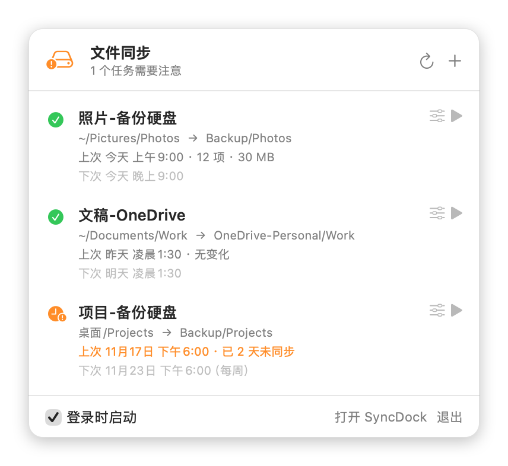
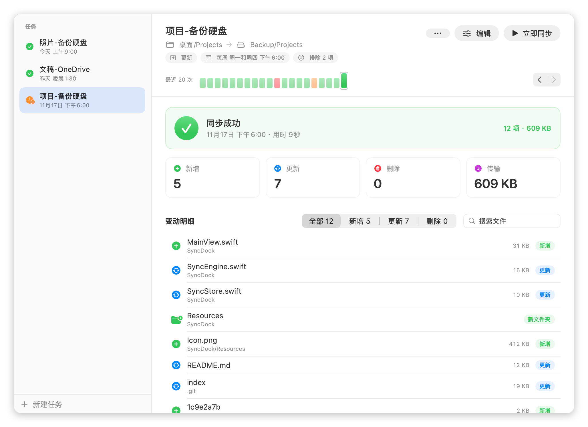
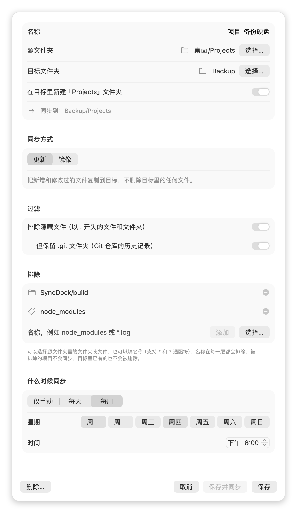
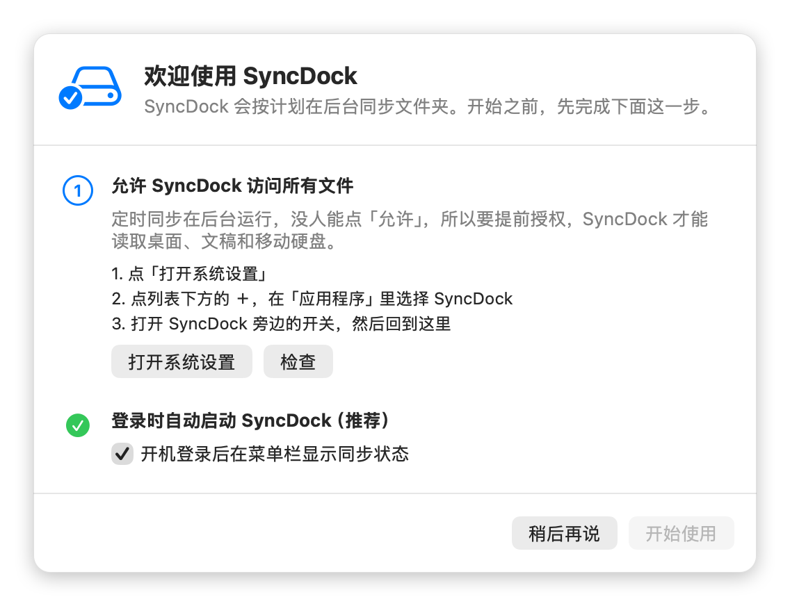

# SyncDock

**中文** | [English](README.md)

一个 macOS 菜单栏小工具，用简单的界面管理文件夹同步：选好源文件夹和目标文件夹，设好什么时候同步，剩下的交给它在后台完成。

同步由 SyncDock 内置的单向同步引擎完成，不需要另外安装任何软件。

<p align="center"></p>

## 下载

**[⬇ 下载 SyncDock（macOS）](https://github.com/yuting-ai/SyncDock/releases/latest/download/SyncDock.dmg)**

macOS 15 或更高版本 · Apple 芯片和 Intel 均可 · 已通过 Apple 公证 · 免费开源（MIT）

所有版本和更新说明：[Releases](https://github.com/yuting-ai/SyncDock/releases)

## 截图

<p align="center"></p>

<table>
  <tr>
    <th>编辑任务</th>
    <th>首次启动引导</th>
  </tr>
  <tr>
    <td valign="top"></td>
    <td valign="top"></td>
  </tr>
</table>

## 功能

- **菜单栏状态**：每个任务上次同步的结果（复制了多少项、多大）、下次什么时候运行。
- **主窗口**：集中管理所有任务：新建、编辑、立即同步、删除；查看每个任务最近 30 次同步的结果、用时、新增 / 更新 / 删除了多少、有哪些错误，以及可搜索的变动文件列表。
- **新建和编辑任务**：选择源文件夹、目标文件夹，默认在目标里新建同名文件夹，并预览实际同步到哪里。
- **两种同步方式**
  - **更新**：只把新增和修改过的文件复制到目标，从不删除目标里的文件（默认）。
  - **镜像**：让目标和源完全一致，源里删掉的文件，目标里也会删掉（移到废纸篓）。
- **过滤**：排除隐藏文件，并可以单独保留 `.git` 文件夹（适合备份代码项目）。
- **排除**：不同步指定的文件夹或文件（比如编译产物文件夹），或者任意层级里某个名称的项目，如 `node_modules`、`*.log`。被排除的项目也不会从目标里删除。
- **定时**：仅手动 / 每天 / 每周几，在后台运行，**不需要开着任何软件**。
- **立即同步**：随时手动同步一次。
- **移动硬盘感知**：硬盘没插时跳过本次同步并发通知，不会把文件写到电脑内置硬盘上。
- **首次启动引导**：检查 SyncDock 是否有「完全磁盘访问权限」，一步步带你完成授权。
- **中文和英文界面**：自动跟随系统语言。

## 系统要求

- macOS 15 或更高版本（Apple 芯片和 Intel 均可）

## 安装

1. [下载 SyncDock.dmg](https://github.com/yuting-ai/SyncDock/releases/latest/download/SyncDock.dmg)，双击打开，把 SyncDock 拖进「应用程序」文件夹。
2. 打开 SyncDock。它常驻在屏幕右上角的**菜单栏**；打开主窗口时，程序坞里也会显示它。
3. 第一次打开时会弹出「欢迎使用 SyncDock」，按提示**允许 SyncDock 访问所有文件**：点「打开系统设置」，在「完全磁盘访问权限」列表里点 ＋，选择 SyncDock 并打开开关。回到 SyncDock 后会自动检查。

> **为什么需要「完全磁盘访问权限」？** 定时同步在后台运行，没有人能点「允许」。提前授权后，SyncDock 才能读取桌面、文稿和移动硬盘里的文件。

### 从 SyncDock 1.x 升级

1.x 版本用 FreeFileSync 执行同步。给 2.0 授予「完全磁盘访问权限」（见上文）后，原有任务会自动迁移到内置引擎，名称、文件夹、同步方式、过滤和定时都保持不变。在授权之前，这些任务仍由 FreeFileSync 照常运行，不会漏掉备份。`~/FreeFileSync` 里的 `.ffs_batch` 文件会原样保留；如果不再用 FreeFileSync，可以把它卸载。

用了 SyncDock 不支持的设置的任务（双向同步、按大小或日期过滤、额外的过滤规则）不会迁移，仍由 FreeFileSync 照常运行，SyncDock 里不再显示它们。

## 使用

点菜单栏里的 SyncDock 可以快速查看所有任务；点面板底部的「打开 SyncDock」（或在「应用程序」里再次打开 SyncDock）进入主窗口。

| 操作 | 主窗口 | 菜单栏面板 |
|---|---|---|
| 新建任务 | 工具栏的 ＋、列表下方的「新建任务」，或 ⌘N | 右上角的 ＋ |
| 编辑任务 | 「编辑」或 ⌘E | 任务右边的 ⚙ |
| 立即同步 | 「立即同步」或 ⌘R；⇧⌘R 同步全部任务 | 任务右边的 ▶ |
| 删除任务 | 「编辑」旁边的 ⋯，或在任务上点右键 | |
| 查看同步做了什么 | 在详情上方的彩色条里选一次同步 | 点任务下面的「上次 …」那一行 |
| 开机自动启动 SyncDock | SyncDock ▸ 设置… | 底部「登录时启动」 |

### 删除任务会怎样？

只删除同步任务和它的定时设置（移到废纸篓），**已经同步过去的文件不受影响**。

## 常见问题

**Mac 睡眠或关机时，定时同步会怎样？**
睡眠时错过的同步会在唤醒后补跑一次；关机时错过的不会补，等下一次定时再跑。另外需要处于登录状态（锁屏没关系）。

**怎么知道同步出错了？**
菜单栏面板里的任务会显示出错，菜单栏图标变成橙色；出错时还会弹出一条通知。点「上次 …」那一行，可以在主窗口里看到具体错误。没有错误时会在后台安静完成。

**移动硬盘没插会怎样？**
这次同步会跳过，并弹出一条通知。下次插着的时候会正常同步。

**提示「目标文件夹不存在」？**
备份文件夹被删除或移动时，定时同步会重新创建它，并给出一条警告提醒你。如果是你自己删的，忽略即可；在 SyncDock 里点 ▶ 手动同步不会出现这条警告。

**怎么判断文件有没有变化？**
和大多数备份工具一样，比较文件大小和修改时间。源文件更新或者大小不同时就复制。「更新」模式下，目标里更新的文件保持不动；「镜像」模式下会换回源里的版本。文件先复制成临时文件再改名替换，同步中途被打断也不会留下写了一半的文件。

**源文件夹不在时，镜像会不会把备份清空？**
不会。源文件夹不存在、读不了，或者源是空的而目标不是空的，同步会报错停止，不会删除任何东西。

## 卸载

1. 在 SyncDock 里逐个删除同步任务（这样会同时移除后台定时设置）。
2. 退出 SyncDock（面板底部「退出」），把它从「应用程序」拖到废纸篓。

如果已经先删除了 SyncDock，后台定时任务仍会继续运行。可以在终端里移除它们：

```bash
for f in ~/Library/LaunchAgents/me.lepton.syncdock.*.plist; do launchctl bootout gui/$(id -u) "$f"; mv "$f" ~/.Trash/; done
```

任务和日志保存在 `~/Library/Application Support/SyncDock`，不需要的话也可以把这个文件夹删掉。

## 工作原理

```
SyncDock（菜单栏 App）
 ├─ 任务     ~/Library/Application Support/SyncDock/Tasks/<id>.json
 ├─ 定时     ~/Library/LaunchAgents/me.lepton.syncdock.<id>.plist    macOS launchd
 └─ 同步记录 ~/Library/Application Support/SyncDock/Logs/<id> <时间>.json / .changes.json

到时间后：launchd → SyncDock --run <id>（不显示界面）→ 检查移动硬盘是否已连接 → 同步 → 写入同步记录 → 菜单栏和主窗口显示结果
```

- 每个任务对应一个 JSON 文件和一个 launchd 定时配置。定时配置用 `--run` 启动 SyncDock 自己的程序，在后台同步完就退出，所以菜单栏 App 不需要开着。
- 后台同步和菜单栏 App 是同一个程序，所以授予 SyncDock 的「完全磁盘访问权限」对后台同步同样有效。SyncDock 通过列出一个只有完全磁盘访问权限才能读的文件夹来检查权限。
- 每个任务运行时持有一个锁文件，防止同一个任务同时运行两次；菜单栏也靠它显示正在进行的同步，不管同步是怎么启动的。
- 每次同步写一份很小的 `.json` 摘要（结果、数量、错误，菜单栏读取它），和一份 `.changes.json` 变动文件列表（最多 5000 项，在主窗口里打开这一次时才读取）。每个任务保留最近 30 次。

## 开发

需要 Xcode 26 或更高版本。

```bash
open SyncDock.xcodeproj   # 然后按 ⌘R 运行
```

运行前先退出已安装的 SyncDock，否则菜单栏会出现两个图标。

| 文件 | 内容 |
|---|---|
| `SyncDock/Main.swift` | 入口：后台同步或菜单栏 App |
| `SyncDock/SyncDockApp.swift` | 菜单栏图标、窗口、菜单 |
| `SyncDock/MenuView.swift` | 菜单栏面板 |
| `SyncDock/EditorView.swift` | 新建 / 编辑任务表单 |
| `SyncDock/SetupView.swift` | 首次启动引导 |
| `SyncDock/MainView.swift` | 主窗口：任务、同步记录、变动文件 |
| `SyncDock/SettingsView.swift` | 设置窗口 |
| `SyncDock/SyncStore.swift` | 状态、立即同步、保存 / 删除任务 |
| `SyncDock/SyncTask.swift` | 任务模型、读取任务和同步记录 |
| `SyncDock/TaskFiles.swift` | 保存任务、launchd 定时、运行锁 |
| `SyncDock/SyncEngine.swift` | 同步引擎：比较、复制、删除、过滤 |
| `SyncDock/SyncRunner.swift` | `--run`：执行一次后台同步、写同步记录、发通知 |
| `SyncDock/Migration.swift` | 把 1.x（FreeFileSync）任务迁移到内置引擎 |
| `SyncDock/Setup.swift` | 检查完全磁盘访问权限 |

### 调试

不用点开菜单栏也能检查界面，把界面渲染成图片：

```bash
SyncDock.app/Contents/MacOS/SyncDock --snapshot out.png                 # 菜单栏面板
SyncDock.app/Contents/MacOS/SyncDock --snapshot out.png new             # 新建任务表单
SyncDock.app/Contents/MacOS/SyncDock --snapshot out.png <任务 id>       # 编辑某个任务
SyncDock.app/Contents/MacOS/SyncDock --snapshot out.png setup           # 引导页
SyncDock.app/Contents/MacOS/SyncDock --snapshot out.png history:<id>    # 主窗口里的某个任务
```

设置环境变量 `SYNCDOCK_HOME=<文件夹>` 可以让 SyncDock 使用另一个文件夹存放任务和同步记录（`<文件夹>/Tasks`、`<文件夹>/Logs`），用演示数据预览各种状态或测试同步。设置了它时，SyncDock 不会改动任何 launchd 定时配置，真实的定时任务不受影响。手动执行一次同步：`SYNCDOCK_HOME=<文件夹> SyncDock.app/Contents/MacOS/SyncDock --run <任务 id>`。

直接运行开发版（⌘R）会操作你真实的任务：会迁移 1.x 的任务，保存的定时配置也会指向开发版程序。

README 里的截图用演示任务渲染，不会出现真实的文件夹名。修改界面后，重新生成中英文截图：

```bash
scripts/make-screenshots.sh
```

### 本地化

界面文字的基准语言是简体中文，英文翻译在 `SyncDock/Localizable.xcstrings`（String Catalog）里，Xcode 编译时会自动提取代码里新增的文字。检查是否还有没翻译的：

```bash
xcodebuild -exportLocalizations -project SyncDock.xcodeproj -localizationPath /tmp/loc -exportLanguage en
```

用指定语言渲染界面：`SyncDock.app/Contents/MacOS/SyncDock --snapshot out.png -AppleLanguages "(en)"`。

### 发布

`scripts/release.sh` 一条命令完成：归档 → Developer ID 签名 → 公证并附上公证结果 → 制作 DMG → DMG 签名、公证 → Gatekeeper 验证。产物在 `build.noindex/release/SyncDock-<版本>.dmg`。

第一次使用前，需要把公证凭证存进钥匙串（需要 Apple ID 的 App 专用密码）：

```bash
xcrun notarytool store-credentials SyncDock-notary --apple-id <Apple ID> --team-id 3TJQ367JDZ
```

发布新版本：在 Xcode 里修改 `MARKETING_VERSION`，然后运行：

```bash
scripts/release.sh
```

只想检查签名和打包、不提交公证时，加 `--skip-notarize`。

发布到 GitHub。DMG 统一以 `SyncDock.dmg` 的文件名上传，这样 README 里的下载链接（`releases/latest/download/SyncDock.dmg`）始终指向最新版本：

```bash
cp build.noindex/release/SyncDock-1.1.dmg build.noindex/release/SyncDock.dmg
gh release create v1.1 build.noindex/release/SyncDock.dmg --title "SyncDock 1.1" --notes "…"
```

## 许可

SyncDock 以 [MIT 许可证](LICENSE) 发布。
